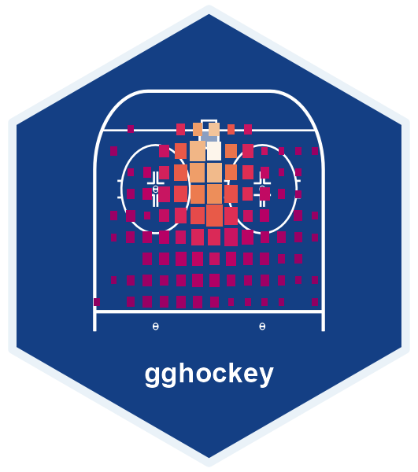

<!-- README.md is generated from README.Rmd. Please edit that file -->

```{r, include = FALSE}
knitr::opts_chunk$set(
  collapse = TRUE,
  comment = "#>",
  fig.path = "man/figures/README-",
  dev = "ragg_png",
  dpi = 144,
  out.width = "100%",
  message = FALSE,
  warning = FALSE
)
```

# gghockey 

<!-- badges: start -->
[](https://github.com/5plusspieldauer/gghockey/actions/workflows/R-CMD-check.yaml)
<!-- badges: end -->

gghockey draws to-scale ice hockey rinks as ggplot2 layers and puts your
event data on them. You get:

* **Rinks** with IIHF or NHL dimensions (or your own), horizontal or
  vertical, cropped to any zones, from a single `annotate_rink()` call.
* **Heatmaps** from `geom_rink_bin()`: a binned geom whose squares are sized
  in rink units, so a map looks the same at any export size. Three styles
  encode the cell value and the event count.
* Matching **scales**, a clean **rink theme**, **team palettes** built from
  your own colours, and optional **centre-ice logos**.
* The rink as **data**: `rink_geometry()` returns every marking as tidy
  coordinates, for use outside ggplot2.

## Installation

```r
# install.packages("pak")
pak::pak("5plusspieldauer/gghockey")
```

## A rink in one line

`annotate_rink()` adds the markings, a fixed-aspect coordinate system and a
theme. Map your data in plain rink coordinates: metres from the bottom-left
corner of the boards, `x` along the length.

```{r rink, fig.height = 3.2}
library(ggplot2)
library(gghockey)

ggplot(shots, aes(x, y)) +
  annotate_rink(details = TRUE) +
  geom_point(aes(colour = factor(goal)), alpha = 0.5, size = 1) +
  scale_colour_manual(values = c("0" = "grey50", "1" = "#C8102E"),
                      labels = c("No goal", "Goal"), name = NULL) +
  labs(title = "1,500 simulated shots")
```

The same data works on a vertical rink, cropped to the offensive zone. Pass
`dimensions = NHL` for a North American rink:

```{r orientations, fig.height = 3}
library(patchwork)

oz <- ggplot(shots, aes(x, y)) +
  annotate_rink(orientation = "vertical", zones = "oz", details = TRUE) +
  geom_point(alpha = 0.25, size = 0.8, colour = "#143F84") +
  labs(title = "IIHF, offensive zone") +
  theme(plot.title = element_text(size = 13))

nhl <- ggplot() +
  annotate_rink(dimensions = NHL, colour = "grey25", fill = "white", details = TRUE) +
  labs(title = "NHL, full rink") +
  theme(plot.title = element_text(size = 13))

oz + nhl + plot_layout(widths = c(1, 2))
```

## Heatmaps

`geom_rink_bin()` bins events into a square grid and averages `z` in each
cell. Pick the style that fits the story; the matching scales are attached
for you.

```{r styles, fig.height = 4.6}
heatmap <- function(style, ...) {
  ggplot(shots, aes(x, y, z = xg)) +
    annotate_rink(orientation = "vertical", zones = "oz",
                  colour = "grey60", linewidth = 0.5) +
    geom_rink_bin(style = style, binwidth = 2, ...) +
    # One shared colour key: fix the limits instead of using each plot's range
    scale_fill_rink(name = "Mean xG", limits = c(0.02, 0.25)) +
    labs(title = paste0('style = "', style, '"')) +
    theme(plot.title = element_text(size = 13, family = "mono"))
}

heatmap("size") + heatmap("fill", gap = 0.15) + heatmap("alpha") +
  plot_layout(guides = "collect") +
  plot_annotation(theme = theme(legend.position = "bottom"))
```

In `"size"`, the area of each square is proportional to the number of shots
and the colour is the mean xG. Squares are drawn in rink units and never get
bigger than one cell, so they can't overlap.

### Your own cell values

`rink_bin()` returns the grid as a data frame, so you can derive any
per-cell value and plot it with `precomputed = TRUE`. Here is each team's
shot share minus the other team's, on a diverging scale:

```{r diff, fig.height = 4}
cells <- rink_bin(shots, x, y, binwidth = 3, by = team)
wide <- merge(
  cells[cells$team == "Lakeside", c("x", "y", "n")],
  cells[cells$team == "Northfield", c("x", "y", "n")],
  by = c("x", "y"), all = TRUE, suffixes = c("_lake", "_north")
)
wide[is.na(wide)] <- 0
wide$value <- wide$n_lake / sum(wide$n_lake) - wide$n_north / sum(wide$n_north)
wide$n <- wide$n_lake + wide$n_north

ggplot(wide, aes(x, y)) +
  annotate_rink(orientation = "vertical", zones = "oz", colour = "grey55") +
  geom_rink_bin(precomputed = TRUE, style = "size", diverging = TRUE, binwidth = 3) +
  scale_fill_rink_diverging(name = "Shot share", labels = c("Northfield", "Even", "Lakeside")) +
  labs(title = "Where each team shoots from more")
```

## Team colours, facets and logos

gghockey ships no team colours or logos (they belong to the teams). Build a
palette from your own colours with `team_palette()`, and put any logo you have
the rights to on the ice with `logos =`.

```{r teams, fig.height = 3.3}
pal <- team_palette(
  team = c("Lakeside", "Northfield"),
  primary = c("#0B3D91", "#C8102E")
)

ggplot(shots, aes(x, y, colour = team)) +
  annotate_rink(zones = c("nz", "oz"),
                logos = list(centre = "man/figures/logo.png"), logo_alpha = 0.35) +
  geom_point(alpha = 0.45, size = 0.9, show.legend = FALSE) +
  scale_colour_team(pal) +
  facet_wrap(~team)
```

## The rink as data

Every marking is available as tidy coordinates, in drawing order:

```{r geometry}
geo <- rink_geometry(IIHF, details = TRUE)
head(geo[, c("shape", "group", "kind", "x", "y")])
length(unique(geo$shape))
```

Change the dimensions to match your data, e.g. a centre-ice origin:

```{r dims}
centred <- rink_dimensions(IIHF, origin_x = -30, origin_y = -15)
range(rink_geometry(centred)$x)
```

## About the data

`shots` is simulated (see `data-raw/shots.R`): the locations and the toy xG
model are invented, not taken from any league or data provider.
